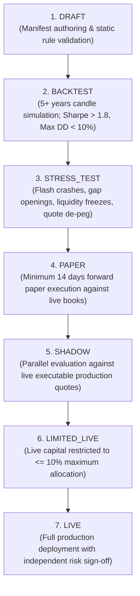

No autonomous agent in Sisera can handle live institutional or user capital without progressing sequentially through a **mandatory 7-stage promotion pipeline** (`POST /v1/agents/:id/promote`).

Each promotion transition is enforced at both the application layer (`@sisera/agent-runtime`) and the **PostgreSQL database trigger layer**, requiring persisted evaluation evidence tied to the exact cryptographic hash of the active manifest version.

---

## The Seven Promotion Stages

| Stage | Gate Identifier | Mandatory Evidence & Qualification Criteria |
| --- | --- | --- |
| **1** | `draft` | Manifest schema validation, non-empty universe, valid stop-loss, drawdown, and notional limits. |
| **2** | `backtest` | Historical simulation across 5+ years of candle history (`POST /v1/agents/:id/backtest`): requires **Sharpe Ratio $> 1.8$** and **Maximum Drawdown $< 10\%$**. |
| **3** | `stress_test` | Survival across simulated regime shocks (`POST /v1/agents/:id/stress_test`): flash crashes, weekend opening gaps, liquidity freezes, and reference quote de-peg events. |
| **4** | `paper` | Minimum **14 days** of forward paper execution against live venue quotes with positive risk-adjusted expectancy. |
| **5** | `shadow` | Parallel evaluation against live production order flow to measure real-world implementation shortfall and slippage accuracy. |
| **6** | `limited_live` | Live capital deployment capped at **$\le 10\%$** of the manifest's `max_capital_usd`. Requires an independent risk manager approval. |
| **7** | `live` | Full production capital allocation with continuous 60-second circuit breaker supervision and independent risk sign-off. |

---

## Automatic Demotion & Circuit Breakers

Even after reaching `limited_live` or `live`, every agent is continuously monitored by automated circuit breakers on every tick:

<Warning>
  **Instant Demotion Triggers:** An active agent is automatically demoted to `paused` or `paper` without waiting for human intervention if any of the following conditions occur:
  1. **Daily Drawdown Breach:** Realized + unrealized daily drawdown exceeds `max_daily_drawdown_pct`.
  2. **Implementation Shortfall Anomaly:** Realized execution slippage exceeds **3×** the backtest/shadow expectation.
  3. **Market Data Degradation:** Connectivity to order book or Pyth reference data degrades for more than **5 seconds**.
</Warning>

### Emergency Fleet Halt

Operators and risk managers can also trigger an immediate fleet-wide or single-agent emergency halt at any time:

- **Single Agent Pause:** `POST /v1/agents/:id/pause`
- **Global Emergency Halt:** `POST /v1/agents/emergency-halt` — Immediately transitions all active live agents to `paused` and cancels pending proposals.
