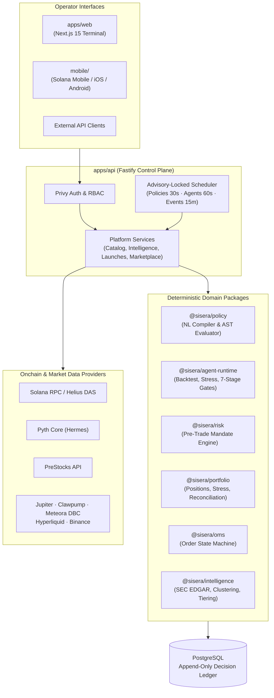

Sisera is architected as a modular TypeScript monorepo with independently deployable applications (`apps/web`, `apps/api`, `mobile`) and framework-neutral domain packages (`packages/*`).

---

## High-Level Topology

---

## Monorepo Package Boundaries

| Path | Package / App | Responsibility |
| --- | --- | --- |
| `apps/web` | `@sisera/web` | Next.js 15 operator terminal: public xStocks, PreStocks, Sisera AI, agents, launch studio, marketplace, portfolio, risk, and activity views. |
| `apps/api` | `@sisera/api` | Fastify control plane: Privy bearer verification, RBAC permissions, venue adapters, platform services, and advisory-locked background loops. |
| `mobile` | `@sisera/mobile` | React Native / Solana Mobile (Seeker) companion app for monitoring positions, agent states, policy approvals, and Clawpump markets. |
| `packages/intelligence` | `@sisera/intelligence` | Source-tier classification, SEC EDGAR parsing (`8-K`, `10-Q`, `10-K`, `S-1`, `13D`), event corroboration clustering, and asset move explanation. |
| `packages/policy` | `@sisera/policy` | Formal condition grammar, natural-language-to-policy compiler, and deterministic policy evaluator. |
| `packages/agent-runtime` | `@sisera/agent-runtime` | Declarative strategy rules, historical backtester, stress-test simulator, 7-stage promotion gate validator, circuit breakers, and autonomy dispositions. |
| `packages/portfolio` | `@sisera/portfolio` | Immutable fill-to-position builder, average-cost & FIFO accounting, underlying economic exposure deduplication, 5 stress scenarios, and onchain reconciliation. |
| `packages/risk` | `@sisera/risk` | Side-effect-free pre-trade risk validator returning machine-readable approval/rejection decisions and mandate utilization snapshots. |
| `packages/market-data` | `@sisera/market-data` | Normalizers and freshness validators for Pyth Core, PreStocks, Jupiter, Clawpump, Hyperliquid, Binance, Polymarket Gamma, FRED, and DeFiLlama. |
| `packages/oms` | `@sisera/oms` | Legal order state transitions (`draft` → `prepared` → `submitted` → `filled` / `rejected` / `canceled`). Venue adapters cannot mutate state directly. |
| `packages/db` | `@sisera/db` | PostgreSQL schema, sequential SQL migrations, append-only triggers, and typed data-access repositories. |
| `packages/domain`, `quant`, `copilot`, `ui` | Shared Libraries | Decimal-string monetary contracts, technical indicators (`EMA`, `RSI`, `ATR`, funding percentiles), OpenRouter structured research clients, and UI primitives. |

---

## The Six Architectural Invariants

Every code path in Sisera enforces six non-negotiable invariants:

<AccordionGroup>
  <Accordion title="1. No Order Routes Without an Approved Risk Decision" icon="shield-check">
    Both paper and live orders—whether initiated manually by a human, triggered by an armed policy, or proposed by an autonomous agent—must pass through `@sisera/risk`. The risk engine loads portfolio state and mandate limits server-side; clients can never supply their own risk limits in a request payload.
  </Accordion>

  <Accordion title="2. No Execution Uses a Stale, Delayed, or Degraded Quote" icon="clock">
    Every market quote carries explicit `source`, `observedAt`, `receivedAt`, and `quality` metadata. If a reference feed (such as Pyth Core) or venue quote is stale or degraded, execution fails closed immediately.
  </Accordion>

  <Accordion title="3. No LLM Response Is Directly Executable" icon="microchip-ai">
    Language models are strictly confined to narrating corroborated evidence and translating natural-language user prompts into candidate policy structures. Only deterministically validated domain commands may enter the order state machine.
  </Accordion>

  <Accordion title="4. Agents Submit Proposals Only—Never Direct Venue Calls" icon="robot">
    Autonomous agents run inside isolated evaluation contexts with hard capital, notional, and leverage caps. An agent never holds wallet keys or invokes a venue adapter directly; it emits a structured proposal that is evaluated by the policy and pre-trade risk engines.
  </Accordion>

  <Accordion title="5. Missing Live Data Never Falls Back to Synthetic Data" icon="ban">
    When an upstream provider is unreachable or an asset lacks a verified reference price, Sisera returns an explicit `unavailable` state and excludes unpriced positions from NAV rather than inventing or interpolating synthetic numbers.
  </Accordion>

  <Accordion title="6. End-to-End Provenance & Append-Only Auditability" icon="file-contract">
    Every execution decision records the exact actor principal, manifest or policy hash, portfolio snapshot, quote provenance, and risk evaluation reasons in append-only PostgreSQL tables. Database triggers reject mutations to activated policies and enforce evidence requirements on agent promotions.
  </Accordion>
</AccordionGroup>

---

## Advisory-Locked Background Scheduler

When `SISERA_SCHEDULER_ENABLED=true` (default), `apps/api` runs four coordinated background loops. Each loop acquires a **PostgreSQL advisory lock**, guaranteeing that even across horizontally scaled API instances, only a single leader executes each cycle:

| Loop | Cadence | Responsibility |
| --- | --- | --- |
| **Policy Evaluator** | Every `30s` | Evaluates all `armed` policies against fresh market data, reference prices, and corroborated events; routes passing policies to the risk engine. |
| **Agent Runtime** | Every `60s` | Executes a tick for active agents (`paper`, `shadow`, `limited_live`, `live`), records decision trails, checks circuit breakers, and processes proposals. |
| **Wallet Leaderboard Refresh** | Every `30s` | Rotates through up to 20 stale tracked Solana and Hyperliquid EVM wallets to recompute realized FIFO and perp P&L. |
| **Intelligence Watchlist** | Every `15m` | Polls SEC EDGAR filings, GDELT, financial news wires, and social feeds; scores source tiers and updates corroborated event clusters. |
