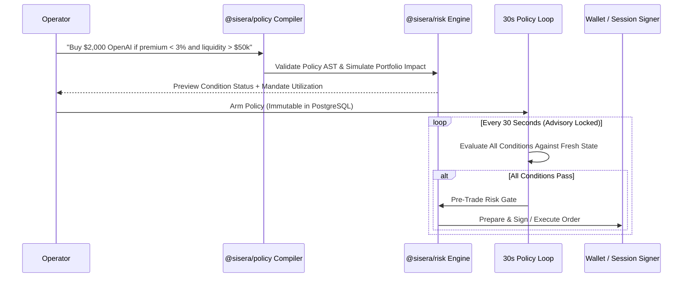

In Sisera, **a language model never executes a trade**. When you give a conditional trading instruction to Sisera AI, `@sisera/policy` resolves the instrument, triggers, allocation, expiry, slippage budget, invalidation rules, and portfolio limits into a formal, immutable **Policy AST**.

<Warning>
  **Fail-Closed Evaluation:** Every policy condition is evaluated deterministically against observed market state. A condition whose required input data is missing, delayed, or stale **never passes**.
</Warning>

---

## Lifecycle of a Trading Policy



---

## The 22 Formal Condition Primitives (`Condition`)

The declarative condition grammar (`@sisera/policy`) is shared across conversational policies and autonomous agent manifests. It comprises **22 strongly typed primitives** across four categories:

<AccordionGroup>
  <Accordion title="1. Valuation, Price & Liquidity Conditions (7 Primitives)" icon="scale-balanced">
    | Condition Type | Parameters | Semantics |
    | --- | --- | --- |
    | `premium_below` | `pct: number` | Passes when token premium/discount vs. Pyth reference or PreStocks mark is $< \text{pct}\%$. |
    | `premium_above` | `pct: number` | Passes when token premium/discount vs. reference mark is $> \text{pct}\%$. |
    | `price_below` | `usd: number` | Passes when current executable price is $< \text{usd}$. |
    | `price_above` | `usd: number` | Passes when current executable price is $> \text{usd}$. |
    | `liquidity_above` | `usd: number` | Passes when onchain pool depth exceeds `usd`. |
    | `volume_24h_above` | `usd: number` | Passes when 24-hour trading volume exceeds `usd`. |
    | `reference_fresh` | *(none)* | Passes only when the Pyth Core / reference quote is fresh and not carried forward. |
  </Accordion>

  <Accordion title="2. Event & SEC EDGAR Intelligence Conditions (3 Primitives)" icon="file-shield">
    | Condition Type | Parameters | Semantics |
    | --- | --- | --- |
    | `no_negative_event` | `minSeverity`, `lookbackHours`, `includeRumors` | Passes only if no negative event at or above `minSeverity` occurred within `lookbackHours`. |
    | `sec_filing_detected` | `lookbackHours`, `itemCode?` | Passes when an official SEC EDGAR filing (optionally matching an `8-K` item code like `2.02` or `1.01`) is detected. |
    | `positive_catalyst` | `minSeverity`, `lookbackHours`, `requireConfirmedOrCorroborated` | Passes when a positive event of at least `minSeverity` is verified as `confirmed` or `corroborated`. |
  </Accordion>

  <Accordion title="3. Technical & Candle Replay Conditions (10 Primitives)" icon="chart-line">
    All technical conditions (`TECHNICAL_CONDITIONS`) can be replayed deterministically from historical OHLCV candles for 5-year agent backtesting:

    | Condition Type | Parameters | Semantics |
    | --- | --- | --- |
    | `ema_trend` | `fast`, `slow`, `direction` (`bullish`\|`bearish`), `requireCross` | Evaluates Exponential Moving Average alignment or fresh crossover. |
    | `rsi_below` | `period` (default `14`), `value` (`0–100`) | Passes when Relative Strength Index falls below `value`. |
    | `rsi_above` | `period` (default `14`), `value` (`0–100`) | Passes when Relative Strength Index rises above `value`. |
    | `breakout_high` | `lookback: number` | Passes when close breaks above the highest high of the prior `lookback` bars. |
    | `breakdown_low` | `lookback: number` | Passes when close breaks below the lowest low of the prior `lookback` bars. |
    | `relative_volume_above` | `lookback` (default `20`), `ratio` | Passes when current bar volume exceeds `ratio` $\times$ average volume over `lookback` bars. |
    | `close_above_sma` | `period: number` | Passes when close is above the Simple Moving Average over `period` bars. |
    | `close_below_sma` | `period: number` | Passes when close is below the Simple Moving Average over `period` bars. |
    | `return_above` | `bars: number`, `pct: number` | Passes when cumulative return over `bars` exceeds `pct%`. |
    | `return_below` | `bars: number`, `pct: number` | Passes when cumulative return over `bars` is below `pct%`. |
    | `change_24h_above` / `change_24h_below` | `pct: number` | Evaluates rolling 24-hour percentage change. |
  </Accordion>

  <Accordion title="4. Derivatives & Basis Arbitrage Conditions (2 Primitives)" icon="percent">
    | Condition Type | Parameters | Semantics |
    | --- | --- | --- |
    | `funding_rate_above` | `aprPct: number` | Passes when annualized perpetual funding rate exceeds `aprPct%`. |
    | `basis_spread_above` | `bps: number` | Passes when the spot-to-reference or spot-to-perp basis exceeds `bps` basis points. |
  </Accordion>
</AccordionGroup>

---

## Example Compiled Policy Payload

```json
{
  "assetKey": "prestocks:OPENAI",
  "side": "buy",
  "notionalUsd": "2000.00",
  "maxSlippageBps": 50,
  "expiresAt": "2026-10-23T18:00:00.000Z",
  "conditions": [
    { "type": "premium_below", "pct": 3.0 },
    { "type": "liquidity_above", "usd": 50000 },
    {
      "type": "no_negative_event",
      "minSeverity": "high",
      "lookbackHours": 24,
      "includeRumors": true
    }
  ]
}
```
