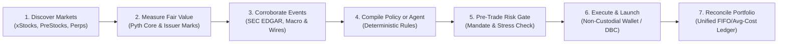

**Sisera** gives traders, quants, and autonomous agents one unified command center to discover stock-linked markets, understand what is moving them, compare onchain prices against authoritative reference values, execute across multiple venues, manage a single reconciled portfolio, and deploy persistent agents that trade continuously inside explicit capital and risk limits.

<Note>
  **Live Terminal:** [https://sisera.xyz](https://sisera.xyz) · **Open-Source Monorepo:** [github.com/hackcat29/Sisera](https://github.com/hackcat29/Sisera) · **Official Solana Mint (`$SISERA`):** `4eTknJyuvzcFNS9swypDsfYnhBFJ4d7VqZTqK21RYUh5`
</Note>

---

## Core Thesis: Financial Instruments, Not Just SPL Tokens

Most interfaces treat tokenized stocks as generic SPL tokens with a price chart and a swap button. **Sisera treats tokenized equities and private-market instruments as institutional financial assets.** Every market in Sisera carries:

- **Reference & Fair-Value Context:** Continuous comparison between 24/7 Solana token prices and underlying equity quotes via **Pyth Core** feeds through Hermes.
- **Implied vs. Mark Valuations:** Dedicated pre-IPO market pricing through **PreStocks** (OpenAI, Anthropic, SpaceX, Neuralink, Kalshi, Anduril, Figure AI, Polymarket).
- **Corroborated Event Intelligence:** Source-tiered news and regulatory filings (SEC EDGAR `8-K`, `10-Q`, `10-K`, `S-1`, `13D`, GDELT, wire services, and social streams) mapped directly to affected assets.
- **Deterministic Policy Execution:** Natural-language trading theses compiled into deterministic, machine-verifiable policies evaluated every 30 seconds.
- **Governed Autonomous Agents:** Persistent strategies governed by immutable manifests, 6 autonomy levels, a database-enforced 7-stage promotion pipeline, and automated circuit breakers.
- **Stock-Paired Agent Launches:** Native token and liquidity creation through **Clawpump** and **Meteora Dynamic Bonding Curves (DBC)** quoted in SOL, USDC, or tokenized equities (`NVDAx`, `AAPLx`, `TSLAx`).

---

## Explore the Platform

<CardGroup cols={2}>
  <Card title="Tokenized Equities (xStocks)" icon="chart-candlestick" href="/markets/tokenized-equities">
    Compare 24/7 Solana equity tokens (`NVDAx`, `AAPLx`, `TSLAx`) against live Pyth Core reference prices, track session dislocations, and arm basis arbitrage policies.
  </Card>
  <Card title="PreStocks Private Markets" icon="building-columns" href="/markets/prestocks-private-markets">
    Trade permissionless pre-IPO exposure to OpenAI, SpaceX, Anthropic, and Anduril ranked by mark-to-market discount, liquidity, momentum, and portfolio fit.
  </Card>
  <Card title="Corroborated Intelligence" icon="newspaper" href="/intelligence/corroborated-events">
    Clustered event streams across SEC EDGAR filings, macro feeds, and tier-1 press—strictly separating verified filings from uncorroborated social rumors.
  </Card>
  <Card title="Deterministic AI Policies" icon="sparkles" href="/intelligence/deterministic-policies">
    Ask Sisera AI why an asset is moving and compile natural-language conditional theses into deterministic policies re-evaluated every 30 seconds.
  </Card>
  <Card title="Autonomous Agents" icon="robot" href="/agents/overview-and-manifests">
    Deploy 24/7 algorithmic strategies governed by hashed manifests, 6 autonomy levels, circuit breakers, and a 7-stage institutional promotion pipeline.
  </Card>
  <Card title="Clawpump & Meteora DBC" icon="rocket" href="/launches/meteora-dbc">
    Turn any Sisera agent into an onchain asset paired with tokenized stocks on Pump.fun or programmable Meteora Dynamic Bonding Curves.
  </Card>
  <Card title="Strategy Marketplace & Leaderboard" icon="trophy" href="/agents/vaults-and-marketplace">
    License proven strategy versions for one-time USDC payouts and track verified live P&L across Solana and Hyperliquid EVM wallets.
  </Card>
  <Card title="Unified Portfolio & Risk Engine" icon="shield-halved" href="/portfolio-and-risk/unified-portfolio">
    Single append-only fill ledger, duplicate economic exposure detection, 5-scenario institutional stress testing, and live onchain wallet reconciliation.
  </Card>
</CardGroup>

---

## Institutional Safety Guarantees

<Steps>
  <Step title="Non-Custodial Signing">
    Sisera never holds user private keys. All live swaps, policy executions, marketplace checkouts, and token launches are constructed and risk-checked server-side, simulated against Solana RPCs, and signed directly in the operator's wallet (with optional Privy delegated session signers for automated policies).
  </Step>
  <Step title="Language Models Never Trade">
    Large language models narrate evidence, explain market moves, and translate user intent into candidate policy ASTs. They **never** produce raw transactions, sign messages, or bypass the deterministic policy evaluator.
  </Step>
  <Step title="Fail-Closed Data Integrity">
    Any condition or risk check with missing, delayed, or stale market data automatically fails closed. Unpriced positions are explicitly labeled and excluded from synthetic NAV fabrication.
  </Step>
  <Step title="Append-Only Audit Trail">
    Strategy manifests, backtest evidence, promotion approvals, policy evaluations, agent tick decisions, and trade fills are recorded in append-only PostgreSQL tables enforced by database triggers.
  </Step>
</Steps>
